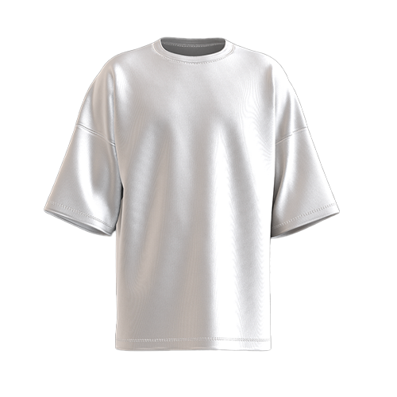

# VirtualThreads — Oversized T-Shirt 3D & 2D Mockup Studio

A high-performance, interactive 3D WebGL and 2D flat apparel mockup studio exclusively focused on the **Oversized Heavyweight T-Shirt** streetwear cut.



---

## ✨ Features

- **Streetwear Oversized Silhouette**:
  - Boxy torso, drop-shoulder seams, and relaxed wide sleeves.
  - Authentic 3D WebGL geometry and 2D flat technical layout.
- **Interactive 3D Viewport**:
  - Orbit, pan, zoom, and rotate around the 3D model.
  - Multi-angle views: **Front**, **Back**, **Left Sleeve**, and **Right Sleeve**.
- **Real-Time Motion & Catwalk Simulations**:
  - **360° Continuous Turntable**: Smooth turntable rotation for showcasing complete artwork wrap.
  - **Fabric Wind Waves**: Micro-cloth physics simulation demonstrating real textile movement.
  - **Runway Walk Stride**: Catwalk stride motion simulation.
  - **Static Studio**: Fixed resting position for precision decal alignment.
- **Artwork & Decal Customization**:
  - Drag-and-drop or upload custom graphics (PNG, JPG, WebP) to front and back.
  - Live Text Tool with font selection, color picker, and real-time canvas stamping.
  - Interactive **2048×2048 High-Resolution Position Guide** with drag, resize, rotate, and live coordinate reflection.
- **Color & Fabric Finishes**:
  - 10 curated streetwear swatches + full custom Hex color picker.
  - Dual-tone interior lighting (realistic lining shadow).
  - Tactile textile finishes: *Combed Cotton Jersey (240 GSM)*, *Heavy French Terry*, and *Mineral Sunfade Wash*.
- **2D Flat View**:
  - Instant toggle between 3D WebGL viewport and 2D flat graphic design view.
- **Export Studio**:
  - 4K transparent or studio-background PNG snapshots.
  - 60 FPS smooth video loops (MP4 / WebM) for social media (TikTok, Instagram, showcase).
- **100% Offline Capable**:
  - Can run standalone without active internet connection.

---

## 🚀 Getting Started

### Prerequisites
- [Node.js](https://nodejs.org/) (v18 or higher recommended)
- `npm`

### Installation & Local Development

1. **Clone the repository:**
   ```bash
   git clone https://github.com/Javid8048/VirtualThread.git
   cd VirtualThread
   ```

2. **Install dependencies:**
   ```bash
   npm install
   ```

3. **Start local dev server:**
   ```bash
   npm run dev
   ```
   Open `http://localhost:3000` in your browser.

4. **Build for production:**
   ```bash
   npm run build
   ```
   The production-ready bundle will be generated in the `dist/` directory.

---

## 💻 Running Offline (Zero Installation)

For running offline on any machine without needing Node.js:

1. **Windows 1-Click Launch**:
   - Double-click `run_offline.bat` (or `start.bat`).
   - Uses built-in Windows PowerShell HTTP serving to launch `http://localhost:8080/`.

2. **Python Launcher**:
   ```bash
   python offline_server.py
   ```

---

## 🌐 GitHub Pages Deployment

This repository includes a pre-configured GitHub Actions workflow (`.github/workflows/deploy.yml`) that automatically builds and deploys the studio to GitHub Pages on every push to the `main` branch.

To enable GitHub Pages:
1. Go to repository **Settings** → **Pages**.
2. Under **Build and deployment** → **Source**, select **GitHub Actions**.
3. Push to `main`, and your site will be live at `https://javid8048.github.io/VirtualThread/`.

---

## 📁 Repository Structure

```
VirtualThread/
├── .github/
│   └── workflows/
│       └── deploy.yml          # Automated GitHub Pages CI/CD
├── public/
│   ├── favicon.svg             # Application favicon
│   ├── garments/               # 2D Flat apparel imagery
│   │   ├── oversized_tee.png
│   │   └── oversized_tee_back.png
│   └── models/                 # 3D GLTF models, textures & lighting
│       ├── tshirt-sizingtest.gltf
│       ├── tshirt-sizingtest.bin
│       ├── studio_env.hdr
│       └── NormalFabric.png
├── src/
│   ├── components/
│   │   ├── ExportPanel.jsx     # High-res image and 60fps video export
│   │   ├── PositionGuide.jsx   # 2048x2048 visual artwork placement
│   │   ├── ProductsCatalogModal.jsx
│   │   └── StaticGarmentView.jsx # 2D flat garment design viewer
│   ├── three/
│   │   ├── ApparelMesh.js      # Procedural fallback apparel geometries
│   │   ├── CanvasDesignManager.js # 2048x2048 dynamic decal composition
│   │   └── SceneManager.js     # Three.js WebGL lighting, cameras, turntable & anim
│   ├── utils/
│   │   ├── assets.js           # Base path resolver for local and GitHub Pages
│   │   ├── presetGraphics.js
│   │   ├── projectManager.js
│   │   ├── textureGenerator.js
│   │   └── videoRecorder.js    # Canvas 60fps WebM/MP4 recorder
│   ├── App.jsx                 # Main Oversized T-Shirt Studio application
│   ├── index.css               # Tailwind CSS & custom styling
│   └── main.jsx                # React DOM entry point
├── index.html
├── package.json
├── tailwind.config.js
├── vite.config.js
├── run_offline.bat
├── start.bat
├── server.ps1
└── offline_server.py
```

---

## 📄 License

MIT License. Designed and developed for VirtualThreads.
